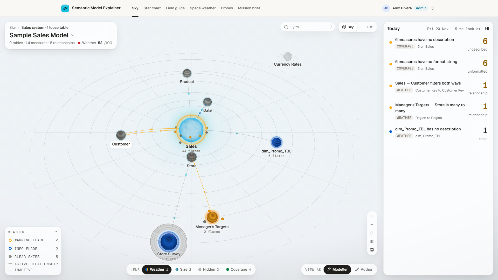

# Semantic Model Explainer

Point the app at a Power BI semantic model and get a readable one-page summary: what is in it, how the tables relate,
which measures exist and how they are written, eight health checks with a score, and ready-made sample questions you can
run. It is a read-only Fabric App (Rayfin 2.0) that reads model metadata through a semantic model connector, so it never
calls the Execute Queries REST API directly and stores nothing.



## What it looks like

The home screen draws the model as a solar system you can fly around (three.js, loaded on demand): fact tables are
stars, dimensions are planets on orbits set by their relationships, measures are moons around their home table, and
every relationship is a trail (solid when active, dashed when inactive, twin trails when it filters both ways, with
particles flowing toward the table being filtered). Hidden objects are ghosts, tables shared by two facts sit between
the stars, and tables with no relationships drift in a belt.

- **Lenses** (keys 1–4): **Weather** (health findings as flares on the tables, moons and trails they affect),
  **Size** (row counts from one batched COUNTROWS query; bigger planet, more rows), **Hidden** (hidden tables and an arc
  for the share of hidden columns), **Coverage** (moons coloured by description and format string).
- **Today** ranks up to five findings; each one flies the camera to the table, measure or relationship behind it and
  switches to its lens. **View as** (key V) switches between the modeller's sky and the report author's (hidden objects
  removed). Fly to any table or measure by name (`/`), `Esc` returns to the whole sky, `?` lists the shortcuts.
- **Tools:** **Star chart** (the 2D relationship diagram and list), **Field guide** (tables with columns and row counts,
  measures with highlighted DAX), **Space weather** (the eight rules, the score ring and every finding, each one click
  from the sky), **Probes** (sample questions), **Mission brief** (printable one-pager with a map, or Markdown).
- **Fallbacks:** the List view holds the same data as an accessible table; without WebGL (or with `?nowebgl`) the sky
  becomes the flat star chart with the same lenses; with reduced motion the orbits stop and the camera jumps.

Screens at 1280 and 390 px, light and dark: [docs/redesign/](docs/redesign/).

Demo video (about 2 minutes, AI-generated narration, captions burned in): [demo/out/model-explainer.mp4](demo/out/model-explainer.mp4) · captions file [demo/out/model-explainer.srt](demo/out/model-explainer.srt). Re-record with `npx tsx tools/demo/record.ts model-explainer` from the repo root.

## 1. Prerequisites

- Microsoft Fabric with the **Fabric Apps** workload enabled (preview) and a workspace on a Fabric capacity.
- **Edit** permission (Contributor or higher) on that workspace to deploy.
- Tenant setting **Semantic Model Execute Queries REST API** enabled (Admin portal, Integration settings). The connector
  uses it under the signed-in user.
- Viewers need access to the app item and **Read + Build** permission on each bound semantic model.
- Node 20 or later.

## 2. Run locally

```bash
npm install            # at the repo root (npm workspaces)
cd apps/model-explainer
npm run dev            # offline demo on http://localhost:5210: three fictional models, persona switcher
npm run dev:fabric     # rayfin dev (note: connectors are not wired under rayfin dev, only after rayfin up)
```

The demo serves three fictional models through `MockModelClient`, so no tenant is needed:

| Demo model | What it shows |
|---|---|
| Sample Sales Model | 9 tables, 14 measures, 8 relationships; every health rule fires once (score 52). Names with spaces, an apostrophe (`Manager's Targets`) and brackets (`Size [cm]`, `Sales [Prior Year]`). |
| Sample Operations Model | 43 tables, no measures: four star systems (two joined by a shared Region) and a belt of 8 loose tables; Probes explains why there is nothing to ask. |
| Sample Finance Model | Measure and relationship metadata blocked (403): those sections degrade, the rest keeps working. |

Tests: `npx vitest run` (92 unit tests) and `npx playwright test` (smoke, acceptance and the sky at 390 px and 1280 px,
and a dry run of the narrated walkthrough). Playwright runs Chromium with software WebGL (SwiftShader) so the 3D sky
renders headless.

## 3. Deploy

The connector's model ids are not in the repo: `rayfin/rayfin.yml` reads them from the environment at `rayfin up`.

```yaml
connectors:
  - name: retail
    type: fabric-semanticmodel
    config:
      workspaceId: ${MODEL_WORKSPACE_ID}   # workspace that holds the semantic model
      itemId: ${MODEL_ITEM_ID}             # the semantic model's item id
```

Deploy with both variables set (Git Bash / macOS / Linux):

```bash
cd apps/model-explainer
MODEL_WORKSPACE_ID=<model-workspace-id> MODEL_ITEM_ID=<model-item-id> npx rayfin up --workspace-id <app-workspace-id>
```

PowerShell: `$env:MODEL_WORKSPACE_ID='<model-workspace-id>'; $env:MODEL_ITEM_ID='<model-item-id>'; npx rayfin up --workspace-id <app-workspace-id>`.

Or from the repo root, with the helper that sets them for you:

```bash
node tools/deploy-app.mjs model-explainer --workspace-id <app-workspace-id> --model-workspace-id <model-workspace-id> --model-item-id <model-item-id>
```

The ids are in the model's URL in the Fabric portal: `.../groups/<workspace-id>/datasets/<item-id>`. The app and the
model can live in different workspaces. `rayfin up` builds with `npm run build:fabric`, uploads `dist/` to Fabric static
hosting and applies the connector configuration. The data service is disabled (`services.data.enabled: false`), so no
SQL database is created.

### Binding more models (up to 3)

1. `npx rayfin connector add` (type `fabric-semanticmodel`, pick the model). This writes `rayfin/connectors/<name>/` and
   a new entry under `connectors:` in `rayfin/rayfin.yml`.
2. In that new entry, replace the literal ids with variables of its own, for example
   `workspaceId: ${MODEL2_WORKSPACE_ID}` and `itemId: ${MODEL2_ITEM_ID}` (and `MODEL3_…` for a third), so no ids are
   committed.
3. Add one line to `src/config/models.ts`: `<name>: 'Label shown in the picker',`. The connector configs and runtimes
   are derived from that map in `src/config/fabric.ts`.
4. Deploy with every variable set, for example
   `MODEL_WORKSPACE_ID=… MODEL_ITEM_ID=… MODEL2_WORKSPACE_ID=… MODEL2_ITEM_ID=… npx rayfin up --workspace-id <app-workspace-id>`
   (`tools/deploy-app.mjs` only sets the first pair; export the others in the shell first).

## 4. Seed

Nothing to seed. The app has no SQL entities and no database: it reads models through connectors, and the demo data is
the fictional mock models in `src/mock/`. `Person` (identity) lives in an in-memory store in both modes. There are no
admin-only features, so no admin needs to be set.

## 5. How it works

| Piece | Where |
|---|---|
| Connector wiring (`connectorsService` + `fabricSemanticModel()` per model, 5,000-row default cap) | `src/config/fabric.ts`, `src/config/models.ts`, `src/app.config.ts` (`fabric: { data: false, extraServices }`) |
| Model picker, query client per model, metadata cache | `src/state/ModelContext.tsx`, `src/components/ModelBar.tsx` |
| Metadata: `INFO.<X>()` then `INFO.VIEW.<X>()` per section, typed `ModelMetadata` | `src/domain/metadata.ts`, `src/domain/parse.ts`, `src/domain/types.ts` |
| Health rules and score | `src/domain/findings.ts`, thresholds in `src/config/rules.ts` |
| DAX builders (quote escaping) | `src/domain/dax.ts` |
| Sample questions | `src/domain/questions.ts` |
| Solar system layout (stars, planets, shared bodies, belt, moons, trails; positions as a function of time) | `src/domain/orrery.ts` |
| Findings mapped to objects (flares), measure coverage, the ranked Today list | `src/domain/weather.ts` |
| The 3D sky (three.js, lazy-loaded), lens encodings, procedural textures | `src/orrery/scene.ts`, `src/orrery/OrreryCanvas.tsx`, `src/orrery/look.ts`, `src/orrery/textures.ts` |
| Star chart layout (hand-written SVG, no graph library) | `src/domain/diagram.ts`, `src/components/StarChart.tsx` |
| DAX highlighting | `src/domain/daxTokens.ts`, `src/components/Dax.tsx` |
| One-pager Markdown | `src/domain/markdown.ts` |
| Mock engine and fixture models | `src/mock/` |

**Entities.** None owned by the app. `Person` and `AppMarker` exist only in `src/model.ts` for the shared runtime and
live in memory.

**Screens.** Sky (the solar system, lenses, Today, view as, fly to, list view) · Star chart (SVG diagram with pan and
zoom by buttons, wheel, drag or keyboard; key; list alternative) · Field guide: Tables (grid, drawer with columns,
on-demand `EVALUATE ROW("n", COUNTROWS('<table>'))`, Count all rows) and Measures (search, filters for missing
description / format string, highlighted DAX with copy) · Space weather (score ring, rule board, findings by severity
with Show in the sky, passed and skipped rules, the score calculation) · Probes (up to 6 numeric measures x 4 related
text or date columns, `EVALUATE TOPN(20, SUMMARIZECOLUMNS('<table>'[<column>], "v", [<measure>]), [v], DESC)`, grid +
bar chart) · Mission brief (map, print, download .md, copy as Markdown). Earlier routes (`#/tables`, `#/health`, …)
redirect to the new ones.

**Health rules.** Measures without a description (warning, more than 20% of visible measures) · Tables without a
description (info, any visible table) · Measures without a format string (warning, numeric measures by DataType: Number,
Currency, Integer, Decimal, Double, Int64) · Bidirectional relationships (warning) · Many-to-many relationships (warning)
· Inactive relationships (info) · Unfriendly names (info: visible tables, columns or measures with underscores, a leading
tbl/dim, or all caps of 4+ letters) · Large wide tables (info, more than 40 columns). **Score = 100 − 10 per warning (at
most 50) − 2 per info (at most 20)**; each rule counts once. Rules whose metadata is unavailable are skipped and listed.

**Security model.** Read-only. Every query goes through `client.connectors.<name>.executeQuery` with delegated auth, so
users only see models they can already query. Results are capped (metadata 20,000 rows, Probes 100 rows, connector
default 5,000), row counts and Probes run only on a click (choosing the Size lens counts rows, 20 tables per query), and every `result.status` is checked before rendering. Names
are always quoted (`'` doubled in table names, `]` doubled in brackets) and generated DAX is checked for balanced
quoting before it runs. Nothing is persisted except the picked model in the viewer's localStorage.

## 6. VERIFY outcomes and known limits

| VERIFY | Outcome |
|---|---|
| DAX INFO functions through the connector | On the test tenant `INFO.TABLES()` / `INFO.MEASURES()` fail through the query API; `INFO.VIEW.TABLES/COLUMNS/MEASURES/RELATIONSHIPS()` work. The app tries `INFO.*` first, falls back to `INFO.VIEW.*`, and marks a section "not available for this model" (category, message, what was tried, Retry) when both fail. Both shapes are parsed (ids and numeric enums for `INFO.*`, names and text enums for `INFO.VIEW.*`); columns are matched by name with brackets stripped; `RowNumber-…` columns are excluded. |
| Measure DAX | On this tenant `INFO.VIEW.MEASURES` returns no expressions (`Expression` is null for every measure), verified against the deployed X10 Retail Demo Model. The Measures tab and one-pager then say "Expressions aren't exposed by the query API for this model" and show everything else. The offline demo models keep their DAX so the expression views can be shown. |
| Model ids in the repo | None: `rayfin.yml` reads `${MODEL_WORKSPACE_ID}` / `${MODEL_ITEM_ID}` at `rayfin up`. Deployed this way, the connector applied successfully. |
| Connector-only project | `services.data.enabled: false`, no `rayfin/data`. The shared runtime gets `fabric: { data: false }` so identity uses an in-memory store. |
| Connectors under `rayfin dev` | Not wired (platform limit); verify after `rayfin up`. |

Known limits:

- Many-to-many and one-to-one relationships with single-direction filtering are drawn with the arrow on the "from" end;
  `INFO.VIEW.RELATIONSHIPS` does not say which way they filter.
- When a measure's DataType is missing, "numeric" is inferred from the DAX (FORMAT/CONCATENATE/string literal = text).
- Sample questions only follow active relationships; questions over a many-to-many relationship may return repeated totals.
- The model picker is the stage title on the Sky and a caption above every tool's title (the shared AppShell has no
  header slot).
- The shared nav is static, so for models with nothing to ask (no measures) the Probes link is hidden with CSS; opening
  `#/probes` directly still explains why there are no questions.
- The 3D sky needs WebGL; without it the Sky shows the star chart with the same lenses, Today and list.
- The Fabric build embeds the Rayfin API URL (it contains the tenant and workspace ids) and the publishable key in the JS
  bundle, as every Rayfin app does. They are not secrets: the backend still requires a Fabric sign-in and checks access.
  The semantic model's ids are not in the bundle (they stay server-side in the connector configuration).

## 7. Later

- Paste-a-link support through a Function (explain any model without rebinding).
- A diff between two models.
- A column-usage scan (which columns no measure or relationship uses).
- Calculation groups, perspectives and roles (RLS) in the summary.

## 8. Gallery

**Title:** 12 Days of Fabric Apps: Day [#] – [Theme]: Semantic Model Explainer

**Blurb (60 words):** Fly around your semantic model. Semantic Model Explainer reads a Power BI model through a Fabric
connector and draws it as a solar system: fact tables are stars, dimensions planets, measures moons, relationships
trails. Lenses show health findings as space weather, row counts, hidden objects and documentation. A Today list flies
you to what to fix first; a printable mission brief shares it.

**Tags:** Partner | 12 Days of Fabric Apps · Semantic model · Power BI · DAX · Data governance · Fabric Apps
