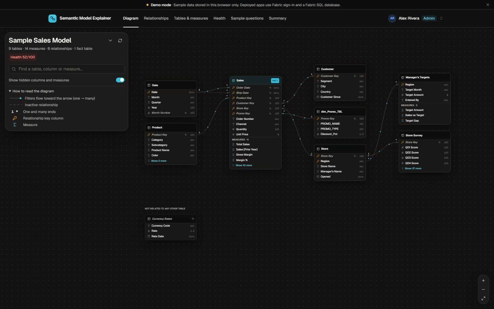
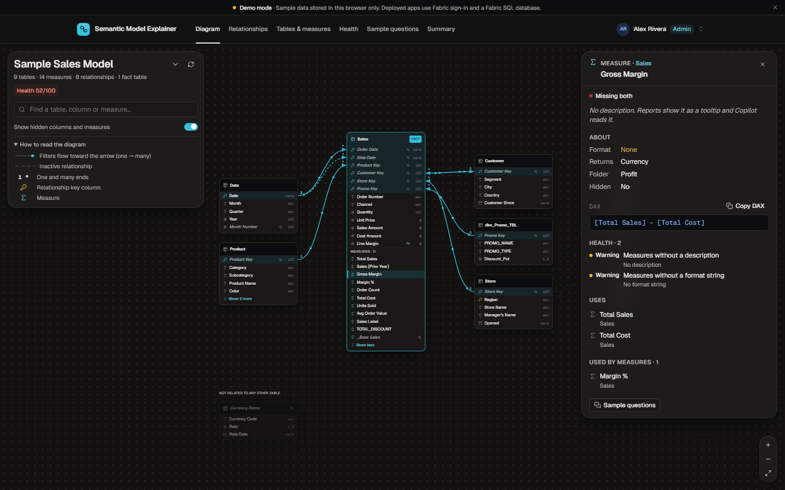
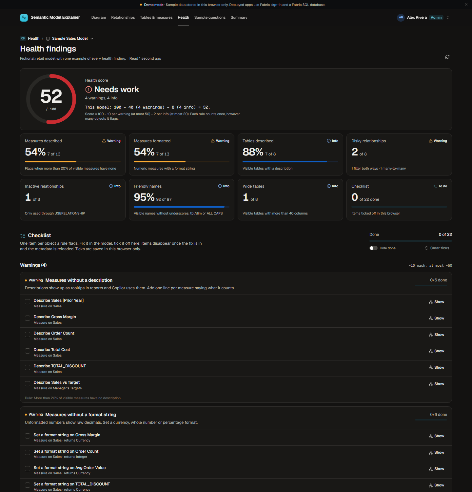
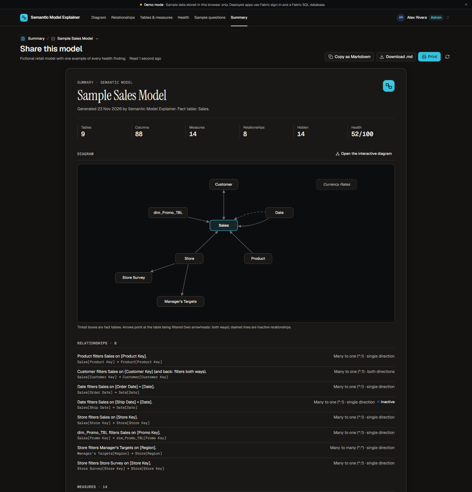

# Semantic Model Explainer

Point the app at a Power BI semantic model and understand it in a couple of minutes: a diagram of every table with its
fields and measures, animated relationships that show which way filters flow, an info panel for anything you click,
eight health checks with a score and a checklist to work through, ready-made sample questions, and a printable summary.
It is a read-only Fabric App (Rayfin 2.0) that reads model metadata through a semantic model connector, so it never
calls the Execute Queries REST API directly and stores nothing on a server.



## About this fork

This is a fork of [Semantic Model Explainer](https://github.com/mjtpena/fabric-app-model-explainer) by Michael John
Peña, used under the MIT licence (the original copyright notice is kept in [LICENSE](../../LICENSE)). The metadata loading,
connector setup, health rules and score, sample questions, deploy tooling and the shared runtime come from the
original project.

What changed in this fork:

- **A new home screen.** The 3D solar-system view (three.js) is replaced by a diagram of table cards listing each
  table's keys, columns and measures, with animated relationship links that show which way filters flow.
- **An info panel.** Click any table, column, measure or relationship for its details, DAX, health findings and usage
  (which measures use a column or another measure).
- **No space theme.** Screens are renamed (Star chart → Relationships, Field guide → Tables & measures, Space weather
  → Health, Probes → Sample questions, Mission brief → Summary); planet, star and moon wording, glyphs and lenses are
  gone, and there is a new logo.
- **Health.** The score ring leads, with indicator tiles for the numbers behind it and a checklist of every flagged
  object to work through, ticked off per model in the browser.
- **Summary.** Every measure with its description and DAX, relationships as sentences, and health alerts with their
  advice; the Markdown export adds a Mermaid diagram.
- **Removed:** the narrated demo walkthrough and video, and screenshots of the old design (new ones are in
  `docs/`).

## Using the app

### Diagram (home)

Every table is a card: its relationship keys first (key mark), then its columns with their type, then its measures (Σ).
Long tables show the first few and a "Show N more" link. Fact tables sit in the centre column with their dimensions
either side; tables with no relationships sit in a grid below.

Relationships run from the key column on one card to the key column on the other. Dots flow along each one the way
filters travel (from the one side to the many side, both ways when it filters both ways), arrowheads mark the filtered
end, and `1` / `*` mark the cardinality. Inactive relationships are dashed and still. With reduced motion the dots stop
and the arrowheads carry the direction.

- **Click anything** to open the info panel: a table, a column, a measure or a relationship line.
  - *Table:* role (fact, dimension, not related), description, column and measure counts, storage mode, row count on
    demand, health findings, every relationship in a sentence, and its measures.
  - *Column:* data type, kind (data or calculated), format, folder, the relationships it keys and the measures that use it.
  - *Measure:* description, format, return type, folder, its DAX with a copy button, health findings, what it uses and
    what uses it.
  - *Relationship:* which table filters which and on what, cardinality, direction, active or not, and both key columns.

  Everything in the panel links onward, so you can walk from a measure to the columns it reads to the relationships
  behind them.
- **Find** any table, column or measure by name. Hover a table or a key column to light up its links.
- **Show hidden columns and measures** off shows roughly what report authors see (relationship keys stay visible).
- Drag to pan, scroll to zoom, `Esc` clears the selection. The selection is in the address
  (`#/?focus=t:Sales`, `c:Sales|Customer Key`, `m:Sales|Total Sales`, `r:<index>`), so links from other screens open it.



### Relationships

A compact diagram of tables and relationships (pan and zoom by buttons, wheel, drag or keyboard, with a key) and the full
list with cardinality, filter direction and status. Selecting a table filters the list.

### Tables & measures

**Tables:** a grid of every table with its role, row count, column and measure counts and notes; a row opens a drawer
with its columns and an on-demand row count (`EVALUATE ROW("n", COUNTROWS('<table>'))`). **Count all rows** counts
every table, 20 per query. **Measures:** search, filters for a missing description or format string, and highlighted
DAX with copy.

### Health

The health score is the headline, in a ring with its status and the calculation. Below it, tiles for the numbers
behind it: measures described, measures formatted, tables described, risky relationships (both-way and many-to-many),
inactive relationships, friendly names, wide tables, and checklist progress. Each tile shows its status as an icon and
a word, and clicking it jumps to its part of the checklist.

The **checklist** has one item per object a rule flags, worded as something to do ("Set a format string on Gross
Margin", "Make Sales → Customer filter one way"), grouped by rule with the rule's advice. Each item links to the object
in the diagram. Tick items off as you fix the model; progress shows per group and overall, and done items can be
hidden. Ticks are saved per model in your browser only. Once a fix is in and the metadata is reloaded, its item goes
away. Passed rules, and rules skipped because metadata could not be read, are listed at the end.



### Sample questions

For up to 6 numeric measures, up to 4 related text or date columns each: "What is [measure] by [column]?" with a
ready-made query (`EVALUATE TOPN(20, SUMMARIZECOLUMNS('<table>'[<column>], "v", [<measure>]), [v], DESC)`) that runs
on a click and answers as a bar chart and a grid.

### Summary

A printable one-pager to share: the counts, a map of tables and relationships, every relationship as a sentence, every
measure grouped by table with its description (or that it has none) and DAX, and the health alerts with their advice
and affected objects. **Copy as Markdown** and **Download .md** give the same content for a wiki or a pull request,
with the map as a Mermaid diagram that GitHub and Azure DevOps render.



### Addresses

The addresses still use the screens' original names. Older aliases (`#/tables`, `#/health`, `#/one-pager`, …)
redirect.

| Screen | Address |
|---|---|
| Diagram | `#/` |
| Relationships | `#/star-chart` |
| Tables & measures | `#/field-guide` (measures: `#/field-guide?tab=measures`) |
| Health | `#/space-weather` |
| Sample questions | `#/probes` |
| Summary | `#/mission-brief` |
| About | `#/about` |

## 1. Prerequisites

- Microsoft Fabric with the **Fabric Apps** workload enabled and a workspace on a Fabric capacity.
- **Edit** permission (Contributor or higher) on that workspace to deploy.
- Tenant setting **Semantic Model Execute Queries REST API** enabled (Admin portal, Integration settings). The connector
  uses it under the signed-in user.
- Viewers need access to the app item and **Read + Build** permission on each bound semantic model.
- Node 20 or later.

## 2. Run locally

```bash
npm install            # at the repo root (npm workspaces)
cd apps/model-explainer
npm run dev            # offline demo on http://localhost:5210: three fictional models, persona switcher
npm run dev:fabric     # rayfin dev (note: connectors are not wired under rayfin dev, only after rayfin up)
```

The demo serves three fictional models through `MockModelClient`, so no tenant is needed. Switch between them with the
model picker:

| Demo model | What it shows |
|---|---|
| Sample Sales Model | 9 tables, 14 measures, 8 relationships; every health rule fires once (score 52). Names with spaces, an apostrophe (`Manager's Targets`) and brackets (`Size [cm]`, `Sales [Prior Year]`). |
| Sample Operations Model | 43 tables, no measures: several star schemas (two joined by a shared Region) and 8 unrelated tables; Sample questions explains why there is nothing to ask. |
| Sample Finance Model | Measure and relationship metadata blocked (403): those sections degrade, the rest keeps working. |

Tests:

```bash
npx vitest run                         # unit tests for the domain logic: metadata, rules, layout, checklist, Markdown
npx playwright install chromium        # once, for the browser tests
npx playwright test                    # smoke and acceptance at 390 px and 1280 px
```

## 3. Deploy

The connector's model ids are not in the repo: `rayfin/rayfin.yml` reads them from the environment at `rayfin up`.

```yaml
connectors:
  - name: retail
    type: fabric-semanticmodel
    config:
      workspaceId: ${MODEL_WORKSPACE_ID}   # workspace that holds the semantic model
      itemId: ${MODEL_ITEM_ID}             # the semantic model's item id
```

Deploy with both variables set (Git Bash / macOS / Linux):

```bash
cd apps/model-explainer
MODEL_WORKSPACE_ID=<model-workspace-id> MODEL_ITEM_ID=<model-item-id> npx rayfin up --workspace-id <app-workspace-id>
```

PowerShell: `$env:MODEL_WORKSPACE_ID='<model-workspace-id>'; $env:MODEL_ITEM_ID='<model-item-id>'; npx rayfin up --workspace-id <app-workspace-id>`.

Or from the repo root, with the helper that sets them for you:

```bash
node tools/deploy-app.mjs model-explainer --workspace-id <app-workspace-id> --model-workspace-id <model-workspace-id> --model-item-id <model-item-id>
```

The ids are in the model's URL in the Fabric portal: `.../groups/<workspace-id>/datasets/<item-id>`. The app and the
model can live in different workspaces. `rayfin up` builds with `npm run build:fabric`, uploads `dist/` to Fabric static
hosting and applies the connector configuration. The data service is disabled (`services.data.enabled: false`), so no
SQL database is created.

### Binding more models (up to 3)

1. `npx rayfin connector add` (type `fabric-semanticmodel`, pick the model). This writes `rayfin/connectors/<name>/` and
   a new entry under `connectors:` in `rayfin/rayfin.yml`.
2. In that new entry, replace the literal ids with variables of its own, for example
   `workspaceId: ${MODEL2_WORKSPACE_ID}` and `itemId: ${MODEL2_ITEM_ID}` (and `MODEL3_…` for a third), so no ids are
   committed.
3. Add one line to `src/config/models.ts`: `<name>: 'Label shown in the picker',`. The connector configs and runtimes
   are derived from that map in `src/config/fabric.ts`.
4. Deploy with every variable set, for example
   `MODEL_WORKSPACE_ID=… MODEL_ITEM_ID=… MODEL2_WORKSPACE_ID=… MODEL2_ITEM_ID=… npx rayfin up --workspace-id <app-workspace-id>`
   (`tools/deploy-app.mjs` only sets the first pair; export the others in the shell first).

## 4. Seed

Nothing to seed. The app has no SQL entities and no database: it reads models through connectors, and the demo data is
the fictional mock models in `src/mock/`. `Person` (identity) lives in an in-memory store in both modes. There are no
admin-only features, so no admin needs to be set.

## 5. How it works

| Piece | Where |
|---|---|
| Connector wiring (`connectorsService` + `fabricSemanticModel()` per model, 5,000-row default cap) | `src/config/fabric.ts`, `src/config/models.ts`, `src/app.config.ts` (`fabric: { data: false, extraServices }`) |
| Model picker, query client per model, metadata cache | `src/state/ModelContext.tsx`, `ModelSelect` in `src/components/common.tsx` |
| Metadata: `INFO.<X>()` then `INFO.VIEW.<X>()` per section, typed `ModelMetadata` | `src/domain/metadata.ts`, `src/domain/parse.ts`, `src/domain/types.ts` |
| Object ids, fact table detection and table roles | `src/domain/model.ts` |
| Diagram layout (cards with rows, columns either side of the facts, links between key rows) | `src/domain/schema.ts` |
| The diagram (HTML cards, SVG links with flowing dots, pan and zoom) and the info panel | `src/components/SchemaDiagram.tsx`, `src/components/InfoPanel.tsx`, `src/pages/DiagramPage.tsx` |
| Which measures use a column or measure (DAX text scan) | `src/domain/usage.ts` |
| Health rules and score | `src/domain/findings.ts`, thresholds in `src/config/rules.ts` |
| Findings mapped to objects, measure coverage, the ranked top issues | `src/domain/issues.ts` |
| Health indicators and the checklist; ticks per model in localStorage | `src/domain/checklist.ts`, `src/state/useChecklistTicks.ts`, `src/pages/SpaceWeatherPage.tsx` |
| Compact relationship diagram and the Summary map (hand-written SVG, no graph library) | `src/domain/diagram.ts`, `src/components/StarChart.tsx`, `src/components/ModelMap.tsx` |
| DAX builders (quote escaping) and highlighting | `src/domain/dax.ts`, `src/domain/daxTokens.ts`, `src/components/Dax.tsx` |
| Sample questions | `src/domain/questions.ts` |
| Summary Markdown and its Mermaid diagram | `src/domain/markdown.ts`, `src/domain/mermaid.ts` |
| Mock engine and fixture models | `src/mock/` |

**Entities.** None owned by the app. `Person` and `AppMarker` exist only in `src/model.ts` for the shared runtime and
live in memory.

**Health rules.** Measures without a description (warning, more than 20% of visible measures) · Tables without a
description (info, any visible table) · Measures without a format string (warning, numeric measures by DataType: Number,
Currency, Integer, Decimal, Double, Int64) · Bidirectional relationships (warning) · Many-to-many relationships (warning)
· Inactive relationships (info) · Unfriendly names (info: visible tables, columns or measures with underscores, a leading
tbl/dim, or all caps of 4+ letters) · Large wide tables (info, more than 40 columns). **Score = 100 − 10 per warning (at
most 50) − 2 per info (at most 20)**; each rule counts once. Rules whose metadata is unavailable are skipped and listed.

**Security model.** Read-only. Every query goes through `client.connectors.<name>.executeQuery` with delegated auth, so
users only see models they can already query. Results are capped (metadata 20,000 rows, sample questions 100 rows,
connector default 5,000), row counts and sample questions run only on a click, and every `result.status` is checked
before rendering. Names are always quoted (`'` doubled in table names, `]` doubled in brackets) and generated DAX is
checked for balanced quoting before it runs. Nothing is persisted except the picked model and ticked checklist items,
both in the viewer's localStorage.

## 6. Platform notes and known limits

| Topic | Behaviour |
|---|---|
| DAX INFO functions through the connector | `INFO.TABLES()` / `INFO.MEASURES()` can fail through the query API while `INFO.VIEW.TABLES/COLUMNS/MEASURES/RELATIONSHIPS()` work. The app tries `INFO.*` first, falls back to `INFO.VIEW.*`, and marks a section "not available for this model" (category, message, what was tried, Retry) when both fail. Both shapes are parsed (ids and numeric enums for `INFO.*`, names and text enums for `INFO.VIEW.*`); columns are matched by name with brackets stripped; `RowNumber-…` columns are excluded. |
| Measure DAX | `INFO.VIEW.MEASURES` may return no expressions (`Expression` null for every measure). Tables & measures, the info panel and the Summary then say the DAX isn't exposed by the query API and show everything else; "uses" and "used by" are unknown without it. The offline demo models keep their DAX so the expression views can be shown. |
| Model ids in the repo | None: `rayfin.yml` reads `${MODEL_WORKSPACE_ID}` / `${MODEL_ITEM_ID}` at `rayfin up`. |
| Connector-only project | `services.data.enabled: false`, no `rayfin/data`. The shared runtime gets `fabric: { data: false }` so identity uses an in-memory store. |
| Connectors under `rayfin dev` | Not wired (platform limit); verify after `rayfin up`. |

Known limits:

- Many-to-many and one-to-one relationships with single-direction filtering are drawn with the arrow on the "from" end;
  `INFO.VIEW.RELATIONSHIPS` does not say which way they filter.
- When a measure's DataType is missing, "numeric" is inferred from the DAX (FORMAT/CONCATENATE/string literal = text).
- "Uses" and "used by" in the info panel come from a text scan of measure DAX, not a parser: references inside comments
  or strings count.
- Sample questions only follow active relationships; questions over a many-to-many relationship may return repeated totals.
- Checklist ticks live in one browser; they are not shared with other viewers or devices.
- The model picker is the title of the diagram's panel and a caption above every other screen's title (the shared
  AppShell has no header slot).
- The shared nav is static, so for models with nothing to ask (no measures) the Sample questions link is hidden with
  CSS; opening `#/probes` directly still explains why there are no questions.
- The Fabric build embeds the Rayfin API URL (it contains the tenant and workspace ids) and the publishable key in the JS
  bundle, as every Rayfin app does. They are not secrets: the backend still requires a Fabric sign-in and checks access.
  The semantic model's ids are not in the bundle (they stay server-side in the connector configuration).

## 7. Later

- Paste-a-link support through a Function (explain any model without rebinding).
- A diff between two models.
- A model-wide unused-columns report (the info panel already shows each column's usage).
- Calculation groups, perspectives and roles (RLS) in the summary.
